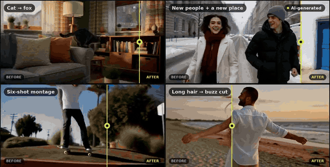

# H3 Create

**Swap people, animals, places and things in any video — locally, with ComfyUI and MiniMax H3.**
Upload a clip, add a picture, write one line ("Replace the woman with @image1."). A local vision LLM watches the clip, plans it
shot by shot, ComfyUI renders it with MiniMax H3, and the same LLM checks every part against the source and retakes what went wrong.

An open-source take on the paid "recast / character swap" video features, built for the
[Open Source Higgsfield challenge](https://comfy.org/open-source-higgsfield). Everything runs on one 16 GB GPU, with open-weights models only.

▶ **Demo video (under 2 min):** [`media/demo.mp4`](media/demo.mp4)



*All people, animals and places shown in this repository are AI-generated (Qwen-Image 2.1 + MiniMax H3). Powered by MiniMax H3.*

---

## What it does

| Tab | What you give it | What you get |
|---|---|---|
| **Create Video → Objects swap** | a video, up to 8 pictures, one line of text | the same video with people, animals, places or things replaced, every shot, every cut, original sound |
| **Create Video → Motion transfer** | a motion video + a picture of a character, object or place | the character from the picture performing the video's motion |
| **Motion Control** | a motion video (3–30 s) + a character picture | the character doing the motion, in the video's scene or in the picture's own place |
| **Edit Video** | a video (+ a prompt or a painted mask) | Edit (change one thing), Extend (sequel / prequel), Reframe (any aspect, the crop follows the subject), Remove Background, SDR → HDR, Depth Map |

## What's different about this approach

Most open recast workflows are one graph: a video, a picture and a prompt go into the model once. H3 Create puts three ideas around
MiniMax H3 that, together, make one-line edits of full-length, multi-shot videos work on a single 16 GB card.

### 1. A local vision LLM (Qwen3.8-27B) directs, prepares and checks the whole job

- **Plans the edit.** Qwen3.8-27B (vision, via llama.cpp) watches the clip at 2 fps with cut detection and turns one line
  ("Replace the man with @image1 and move them to the village in @image3") into a shot-by-shot plan: who is where in every shot,
  what each picture replaces, costumes per shot, places, and a separate prompt for each part that names only the subjects in it.
- **Checks every part against the source.** At the same moments it compares source and result: the original person left over,
  extra copies, wrong costume, the old place coming back, objects that never changed. A failed part gets one targeted retake, not a reroll.
- **Picks between takes.** Where the app makes candidates (first frames, retakes, object fixes), the LLM rates them and the best one is kept.
- **Shares the GPU.** The LLM and H3 take turns on the card: the app frees ComfyUI's VRAM before the LLM loads and stops the LLM before
  the next render.

### 2. The source video is prepared before H3 sees it

H3 copies whatever is in the source, so the app fixes the source first instead of hoping the prompt wins:

- **A pinned first frame (Motion transfer / Motion Control).** The motion video's person is cut out (SAM 3) as a pose reference,
  Qwen-Image makes candidate first frames with your character in that pose, Qwen3.8 rates them for identity, pose and background,
  and the chosen frame is pinned as frame 0. With "the picture's place" an empty plate of that place is made first.
- **The old place taken out.** When a new place keeps losing to the old one, the shot's source window is rebuilt with the subject
  cut out and laid over the new place, which is moved with the source camera (pans, tilts, zooms), so H3 keeps the new place.
- **Things that would leak, erased.** For example, long hair or braids are erased from the source (SAM 3 outlines, filled in) before a
  person is turned into an animal, robot or helmeted figure, so H3 has no flying braids to copy.

### 3. Two swap paths: people and places vs small things

The app routes each subject automatically (`server/pipeline.py`, `recipe/`):

- **People, animals and places** go through H3 + the Character Swap LoRA in parts of up to 5 seconds, each **rendered whole**.
  Long clips are split at scene cuts where possible; inside a shot each part continues from the last 5 frames of the previous one,
  the joins are cross-faded, and the source audio is put back.
- **Things** (a phone, a hat, a frisbee) go through an object recipe. SAM 3 finds and outlines each object, Qwen3.8 picks the
  instances the prompt means, and every shot gets its own prompt and reference sheet. An automatic fixer (`recipe/autofix.py`)
  then looks for leftovers, strays and misses. It can redraw just those boxes with H3 (a small masked-latent node,
  `comfyui_nodes/h3studio_masked_edit.py`) or erase a leftover with MiniMax-Remover and let H3 refine the spot, then keep the best take.

Small objects need tight, per-shot control; people and places need whole, continuous renders. Running both through one path broke one or the other.

## How it works

```
 your video + pictures + one line
            │
            ▼
 Qwen3.8-27B (llama.cpp, vision) ── watches frames at 2 fps + cut detection
            │   writes: subjects (what each picture replaces), shots with times, per-part prompts
            │   routes: people / animals / places ─────────────┐        things (objects) ─────────────┐
            ▼                                                  ▼                                       ▼
 split into ≤124-frame parts (24 fps)              People path                              Object recipe
 at scene cuts when they fall well           each part rendered whole by H3        SAM 3 finds + outlines each object
            │                                continues from the last 5 frames      Qwen picks the meant instances
            ▼                                        │                              one prompt + reference sheet per shot
 ComfyUI API  (native nodes)                          │                                       │
   MiniMax H3 Ref2VA int8                             ▼                                       ▼
 + Character Swap LoRA v1.5 (strength 1)   Qwen checks each part vs the source    autofix: finds leftovers / strays / misses
 + 8-step turbo LoRA, shift 12/3,          (leftovers, copies, costume, place)    H3 redraws just those boxes, or MiniMax-Remover
   er_sde, 8 steps, cfg 1                  → one automatic, targeted retake       erases a leftover and H3 refines; best take kept
            │                                        │                                       │
            └────────────────────────────────────────┴───────────────────────────────────────┘
                                                     ▼
                             parts cross-faded, source audio muxed back → result.mp4
```

- `server/pipeline.py`: planning, the two paths, prompts, checks and retakes, joins.
- `server/h3.py` and `server/workflows.py`: build the ComfyUI graphs (API format) from **native ComfyUI nodes only**:
  `UNETLoader`, `CLIPLoader` (type `minimax`), `VAELoader`, `LoraLoaderModelOnly`, `MiniMaxH3SigmaShift`, `MiniMaxH3ReferenceToVideo`,
  `MiniMaxH3AddGuide`, `LoadVideo`, `GetVideoComponents`, `LoadImage`, `SamplerCustomAdvanced`, `VAEDecode`, `VAEDecodeAudio`, `CreateVideo`, `SaveVideo`
  (+ `MiniMaxH3FunControlNetApply` for Edit's Draw mode).
- `server/comfy.py`: a small ComfyUI API client: queue the graph (`/prompt`), follow sampler progress over the websocket, read `/history`, free VRAM.
- `server/llm.py`: starts `llama-server` with Qwen3.8-27B only when needed. On a 16 GB card the LLM and H3 take turns: the app frees
  ComfyUI's VRAM before the LLM loads, and stops the LLM before the next render.
- `recipe/`: the object recipe (`redoutline3.py`) and its automatic fixer (`autofix.py`, `vace/` helpers).
- `tools/`: SAM 3, MoGe-2 and HDR helpers, each run as its own process.
- `comfyui_nodes/h3studio_masked_edit.py`: a small ComfyUI node that turns the source clip into H3's starting latent with a noise mask, so H3 redraws only the masked boxes (used by the object fixes).
- `workflows/h3_swap_api.json`: the exact graph the app sends for one part (open it in ComfyUI: *Workflow → Open*, or drag it onto the canvas).
  `h3_swap_continue_api.json` is the same with the 5-frame continuation guide.

## Requirements

- Linux with an NVIDIA GPU with **16 GB VRAM or more** (tested: RTX 5080 16 GB, driver 595, CUDA 13 / 12.8), **64 GB RAM or more** (H3's int8 weights
  and text encoder are offloaded; tested with 128 GB), about **90 GB of disk** for the models.
- Python 3.12, FFmpeg, git, CMake + the CUDA toolkit (to build llama.cpp).
- A Hugging Face account with access to [facebook/sam3](https://huggingface.co/facebook/sam3) (gated) for Objects swap with things,
  Remove Background and Reframe.

Speed on the RTX 5080: a 5-second part takes about 6–7 minutes at 768p (2–3 at 480p "Fast"), plus about a minute of LLM planning and checks.
A 15-second, 3-shot people swap takes 20–35 minutes, including any automatic retake.

## Setup

### 1. ComfyUI

Install a recent ComfyUI; MiniMax H3 support is built in (tested at commit `08ff3c1`, 2026-10-09). Follow the
[ComfyUI install guide](https://github.com/comfyanonymous/ComfyUI#installing), then start it:

Copy this repo's one small custom node (used by the automatic object fixes to let H3 redraw only a masked region) into ComfyUI, then start it:

```bash
cp comfyui_nodes/h3studio_masked_edit.py ~/ComfyUI/custom_nodes/
cd ~/ComfyUI && python main.py --listen 127.0.0.1 --port 8188
```

### 2. Models (~60 GB core)

```bash
git clone <this repo> h3-create && cd h3-create
python3 scripts/download_models.py --list                                   # what will be fetched, and from where
python3 scripts/download_models.py --comfy ~/ComfyUI --llm ~/models/qwen38  # core: MiniMax H3 + Character Swap LoRA + Qwen3.8-27B
python3 scripts/download_models.py --comfy ~/ComfyUI --groups edit,control  # optional: Edit 'Draw' mode, Motion Control image scene
```

Files are checked by size and sha256 and the download resumes if interrupted. By downloading you accept each model's license
(see [THIRD_PARTY.md](THIRD_PARTY.md); MiniMax H3's license has an *Applicable Territory* section — read it first).

### 3. llama.cpp (serves Qwen3.8-27B)

```bash
git clone https://github.com/ggml-org/llama.cpp ~/llama.cpp && cd ~/llama.cpp
cmake -B build -DGGML_CUDA=ON -DCMAKE_BUILD_TYPE=Release
cmake --build build --config Release -j --target llama-server
```

Tested at commit `19ab5a5`. If your system compiler is newer than your CUDA toolkit supports, add `-DCMAKE_CUDA_HOST_COMPILER=/usr/bin/g++-14`.
The app starts and stops `llama-server` itself (port 8091), with `--fit-target 700 -c 16384 -fa on --jinja -ctk q8_0 -ctv q8_0`.

### 4. The app

```bash
cd h3-create
python3 -m venv .venv
.venv/bin/pip install -r requirements.txt
# SAM 3 (Objects swap with things, Remove Background, Reframe): install PyTorch for your CUDA first (https://pytorch.org), then
.venv/bin/pip install -r requirements-sam3.txt
.venv/bin/hf auth login          # after your access to facebook/sam3 is approved
cp .env.example .env             # edit paths if yours differ from the defaults
.venv/bin/python scripts/check_setup.py
./run.sh                         # → http://127.0.0.1:7880
```

`scripts/check_setup.py` lists every program, node, model and Python package the app needs and says what is missing.
One virtual environment can run everything; if packages clash, point `H3C_PY_SAM3` / `H3C_PY_MOGE` / `H3C_PY_REMOVER` at separate ones.

### 5. Optional extras

- **MiniMax-Remover** (automatic object fixes: erases a leftover object so H3 can redraw the spot — recommended for Objects swap with things):
  ```bash
  git clone https://github.com/zibojia/MiniMax-Remover ~/minimax-remover
  python3 -m venv ~/minimax-remover/.venv && ~/minimax-remover/.venv/bin/pip install -r ~/minimax-remover/requirements.txt
  python3 scripts/download_models.py --remover ~/minimax-remover --groups remover
  ```
- **MoGe-2** for the Depth Map tool: `pip install -r requirements-moge.txt` (in the env named by `H3C_PY_MOGE`).

## Using it

1. Open http://127.0.0.1:7880 → **Create Video** → **Objects swap**.
2. Drop in a video, or open the **Motion Library** (the clips in `examples/library`).
3. Add pictures (`+`). Refer to them as `@image1`, `@image2`… in the prompt.
4. Write one line, e.g. `Replace the man with @image1 and the woman with @image2, and move them to the desert village in @image3.`
5. Pick **Full length** or **First 5 s**, **768p** or **Fast (480p)**, leave **Check** on, press **Generate**.
6. Follow the stages live; open the finished video in **History** to see each part, its prompt, the check's verdict and any retake.

Try the bundled examples (all synthetic):

| Library clip | Pictures (`examples/pictures`) | Prompt |
|---|---|---|
| Two friends on a snowy street | `p04_new_man.jpg`, `p04_new_woman.jpg`, `p04_desert_village.jpg` | `Replace the man with @image1 and the woman with @image2, and move them to the desert village in @image3.` |
| Street to flamenco stage | `p01_new_woman.jpg` | `Replace the woman with @image1.` |
| Beach, long red hair | `p02_buzzcut_man.jpg` | `Replace the woman with the man from @image1.` |
| House cat | `p07_red_fox.jpg` | `Replace the cat with the red fox from @image1.` |

## Configuration

All settings are environment variables (or lines in `.env`); see `.env.example`.

| Variable | Default | Meaning |
|---|---|---|
| `H3C_HOST`, `H3C_PORT` | `127.0.0.1`, `7880` | where the web app listens (`0.0.0.0` to share it on your network) |
| `H3C_DATA` | `./data` | uploads, jobs, results, logs |
| `H3C_LIBRARY` | `./examples/library` | videos offered in the Motion Library (`library.json` there gives titles) |
| `H3C_COMFY_URL`, `H3C_COMFY_DIR` | `http://127.0.0.1:8188`, `~/ComfyUI` | the running ComfyUI and its folder (inputs are copied into `input/`) |
| `H3C_LLAMA_SERVER`, `H3C_LLM_MODEL`, `H3C_LLM_MMPROJ`, `H3C_LLM_PORT`, `H3C_LLM_CTX` | `~/llama.cpp/build/bin/llama-server`, `~/models/qwen38/…`, `8091`, `16384` | the LLM |
| `H3C_PY`, `H3C_PY_SAM3`, `H3C_PY_MOGE` | the app's Python | interpreters for the helper processes |
| `H3C_REMOVER_DIR`, `H3C_PY_REMOVER` | `~/minimax-remover`, its `.venv` | MiniMax-Remover |

The object recipe is on by default; put `{"enabled": false}` in `data/swap_recipe.json` to send things through the people path too.

## Known limits

- Inside one 5-second part, H3 sometimes places a cut 0.3–0.9 s early.
- An empty wide or aerial shot of a *replaced* place can come out at street level when the place picture is a street-level photo.
- Close-ups that show only hands can keep the original's sleeves.
- Very fast montages (many sub-second shots) vary from take to take.
- The check is good but not perfect: in one test it passed a part where the original's ponytail showed for a moment during a spin.
- Object swaps: a line written for the whole clip can leak into a shot where it doesn't apply (in one 480p test, "caught in the dog's mouth" from the last shot made H3 draw a dog holding the pizza in a shot where the frisbee lies alone on the sand), and the check can miss it.
- The LLM and H3 cannot share a 16 GB card, so they take turns; a bigger card would let them overlap.

## Responsible use

This is a face/body-swapping tool. Only use footage and pictures you have the rights to, and never put a real person into a video
without their consent. Label what you publish as AI-generated. MiniMax H3's Acceptable Use Policy applies to everything you make with
it (no impersonation without consent, no deceptive or harmful content, disclose machine-generated content). Outputs written by the app
carry an "AI-generated" note in their metadata.

## License

The code in this repository is MIT ([LICENSE](LICENSE)). Models and other software are under their own licenses
([THIRD_PARTY.md](THIRD_PARTY.md), [NOTICE](NOTICE)). The example media are AI-generated and offered under CC BY 4.0.

## Credits

[ComfyUI](https://github.com/comfyanonymous/ComfyUI) · [MiniMax H3](https://huggingface.co/MiniMaxAI/MiniMax-H3) and the
[Comfy-Org repackage](https://huggingface.co/Comfy-Org/MiniMax-H3) · [H3 Character Swap LoRA](https://huggingface.co/akatz-ai/MiniMax-H3-Character-Swap-LoRA) by Akatz Labs ·
[Qwen3.8-27B](https://huggingface.co/unsloth/Qwen3.8-27B-GGUF) · [llama.cpp](https://github.com/ggml-org/llama.cpp) · [SAM 3](https://huggingface.co/facebook/sam3) ·
[MiniMax-Remover](https://github.com/zibojia/MiniMax-Remover) · [Qwen-Image 2.1](https://huggingface.co/Comfy-Org/Qwen-Image-2.1) · [MoGe](https://github.com/microsoft/MoGe) · [FFmpeg](https://ffmpeg.org)
